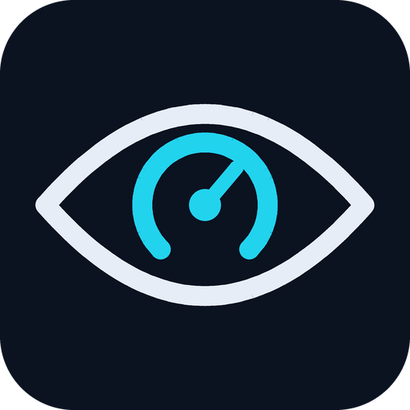
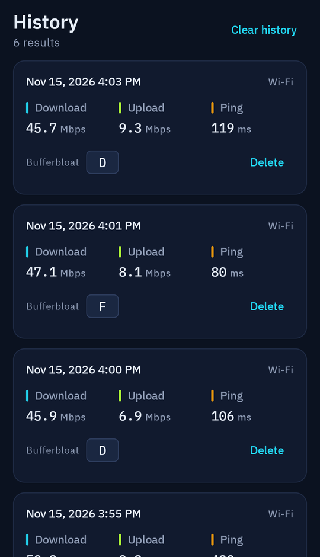
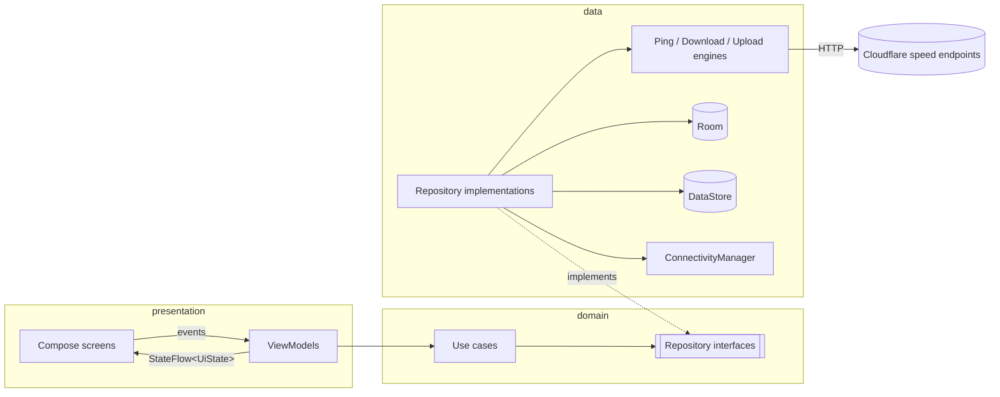

# Netra

[](https://github.com/willyrafaelfs/Network-Speed-Test/releases/latest)
[](https://github.com/willyrafaelfs/Network-Speed-Test/actions/workflows/ci.yml)
[](https://gitlab.com/willyrafaelfs/Network-Speed-Test/-/pipelines)
[](https://gitlab.com/willyrafaelfs/Network-Speed-Test/-/pipelines)


[](LICENSE)

Netra is an Android network speed test that measures **ping, jitter, download, upload, and latency under load**
in real time. It's built with Jetpack Compose and Clean Architecture. The name means "eye" in Sanskrit and
Javanese: an instrument for seeing how your connection behaves.

| Live test (dark) | Result (light) | History |
|---|---|---|
|  |  |  |

## Download

Get the signed APK from the [latest release](https://github.com/willyrafaelfs/Network-Speed-Test/releases/latest)
(Android 7.0 or newer). Each release also lists a SHA-256 checksum:

```bash
sha256sum -c netra-v2.0.0.apk.sha256
```

Netra sends nothing but test traffic: no accounts, no analytics. See the [privacy policy](docs/PRIVACY.md).

## Features

- **Full speed test**: ping → download → upload, with a live animated gauge and per-phase progress
- **Multi-stream engine**: 4 parallel TCP connections, TCP slow-start excluded, and the result reported as the
  90th percentile of 1-second windows
- **Accurate upload**: the final result only counts bytes the server has acknowledged, not bytes sitting in the
  socket send buffer
- **Latency under load & bufferbloat grade (A+ to F)**: ping keeps running during download and upload
- **Latency & jitter**: the median of 10 HTTP round-trips after a warm-up request, so neither the TLS handshake
  nor one slow request skews it
- **Real-time sampling**: throughput is emitted every 250 ms as a Kotlin `Flow`
- **Clear errors**: no connection, timeout, and server rejection are told apart and explained in plain language
- **Instrument-style UI**: custom design system (navy base, one color per channel: cyan download, lime upload,
  amber latency), IBM Plex with tabular numerals, a ticked dial, and an oscilloscope-style live chart
- **Light & dark themes**, English and Indonesian (with per-app language on Android 13+)
- **Adaptive layout**: bottom bar on phones, navigation rail and two panes in landscape and on tablets
- **Accessible**: every reading is announced as one sentence, touch targets are at least 48 dp, and layouts
  scroll at large font sizes
- **Network info**: connection type (Wi-Fi / cellular / Ethernet / VPN), SSID or carrier name, and public IP,
  updated live as the network changes
- **History with trends**: every result is stored locally with Room, including its speed trace. A daily-average
  chart shows download, upload, or ping over time, filtered by Wi-Fi or mobile data
- **Result details & sharing**: open any result to see its chart and an explanation of the latency rise, then
  share it as an image (the Wi-Fi name and IP address are never included)
- **Settings**: test duration, number of parallel connections, Mbps or MB/s, light/dark/system theme, and
  wallpaper colors on Android 12+
- **Cancellable**: stopping a test cancels the running measurement and closes its connections

## Tech stack

| Area | Choice | Why |
|---|---|---|
| UI | Jetpack Compose, Material 3 with a custom theme, Canvas | The dial and charts are drawn directly on Canvas, with no chart library, so they match the design system exactly |
| Navigation | Navigation Compose with type-safe routes, Material 3 adaptive navigation suite | The compiler checks route arguments, and the bottom bar or rail is picked from the window size |
| Architecture | Clean Architecture (domain / data / presentation), MVVM, unidirectional data flow | The engine and storage can be swapped and tested behind interfaces; the UI renders one immutable state |
| Async | Kotlin Coroutines & Flow | Live samples are a natural stream, and cancelling a test cancels every connection |
| Networking | OkHttp 5 (HTTP/1.1) | Low-level control over connections, needed for parallel streams and accurate byte counting |
| Persistence | Room, DataStore Preferences | Room for relational history with tested migrations; DataStore for typed, async settings |
| DI | Hilt | Wiring that is checked at compile time, plus test modules that swap the engine for fakes |
| Release | R8 (minify + resource shrinking), APK signing in CI | A signed 2.3 MB APK. The key lives only in CI secrets, never in the repo |
| Quality | Spotless + ktlint (Compose rules), Detekt, Android Lint (warnings as errors), Kover | Style and static analysis are enforced in CI, not left to review |
| Testing | JUnit, coroutines-test, Turbine, MockWebServer, Robolectric, Compose UI test, Hilt testing, Roborazzi | Every layer is tested on the JVM, so CI needs no emulator |
| CI/CD | GitHub Actions & GitLab CI | Both run the same checks; a version tag publishes signed releases on both |

## Architecture



- **domain** is pure Kotlin: models, repository contracts, and use cases. `RunSpeedTestUseCase` orchestrates the
  ping → download → upload phases and emits a `SpeedTestProgress` stream.
- **data** implements the contracts. Each engine measures one metric and exposes its samples as a `Flow`.
- **presentation** holds Hilt ViewModels that expose an immutable `UiState` through `StateFlow`, and stateless
  composables that render it.

## How the measurement works

| Metric | Method |
|---|---|
| Ping | 10 sequential HTTP requests to a 0-byte endpoint after one warm-up request; the result is the median RTT, so one slow request can't skew it |
| Jitter | Mean absolute difference between consecutive ping samples (RFC 3550 style) |
| Download | 4 parallel HTTP/1.1 connections for 10 s. The first 2 s (TCP slow start) are dropped, and the result is the 90th percentile of 1 s sliding windows |
| Upload | 4 parallel connections repeatedly POST fixed-size random bodies (64 KiB, doubling up to 16 MiB). The final result counts only requests the server has answered |
| Latency under load | A ping every 500 ms on a separate connection while download/upload runs; the median per phase |
| Bufferbloat grade | Worst latency increase over idle, graded with the [Waveform](https://www.waveform.com/tools/bufferbloat) thresholds (A+ ≤ 5 ms … F > 400 ms) |

ICMP ping needs root access on Android, so HTTP round-trip time is used as the latency proxy. The reasoning
behind each choice, the alternatives considered, and the limitations are written up in
[ADR 001: Measurement methodology](docs/adr/001-measurement-methodology.md).

**Known limitations:** HTTP RTT reads slightly higher than ICMP ping, all traffic goes to the nearest
Cloudflare edge, and one connection failing mid-test fails the whole phase.

## Getting started

**Requirements:** Android Studio (latest stable), JDK 21, Android SDK 37.

```bash
git clone https://github.com/willyrafaelfs/Network-Speed-Test.git
cd Network-Speed-Test
./gradlew assembleDebug        # APK in app/build/outputs/apk/debug/
```

Or open the project in Android Studio and run the `app` configuration. Debug builds install as
`io.github.willyrafaelfs.speedtest.debug`, so they can sit next to the release version.

### Release build

`./gradlew assembleRelease` builds a minified APK. It is signed when a key is available, from the
`NETRA_KEYSTORE_PATH`, `NETRA_KEYSTORE_PASSWORD`, `NETRA_KEY_ALIAS`, and `NETRA_KEY_PASSWORD` environment variables
or from `~/.android/netra-release.properties`. Otherwise it is left unsigned.

Pushing a tag such as `v2.0.0` runs [`release.yml`](.github/workflows/release.yml). It builds and verifies the
signed APK and publishes a GitHub Release with the tag notes, an automatic changelog, the APK, its SHA-256, and the
R8 mapping file. GitLab CI creates the matching GitLab Release, which links to the same APK.

### Quality checks

```bash
./gradlew spotlessApply                     # auto-format Kotlin & Gradle scripts
./gradlew spotlessCheck detekt lintDebug    # static analysis
./gradlew verifyRoborazziDebug :app:coverageSummary   # tests + screenshot diff + coverage, as in CI
./gradlew recordRoborazziDebug              # update screenshot baselines after an intended UI change
```

## Testing

Everything runs on the JVM, so CI needs no emulator. Robolectric provides the Android framework.

| Layer | What is tested | How |
|---|---|---|
| Domain | Use cases, bufferbloat grading, error mapping | Plain JUnit with fakes |
| Engine | Throughput math, download/upload/ping against a bandwidth-throttled server, cancellation, HTTP errors | MockWebServer |
| Data | Room DAO (relations, daily aggregates, cascade delete), DataStore settings | Robolectric, in-memory Room, temporary DataStore |
| Migrations | Schema v1 to v3 | `MigrationTestHelper` (instrumented, `androidTest`) |
| ViewModels | Success, phase order, cancel, error, failed save, filters | Turbine + `kotlinx-coroutines-test` |
| UI | Start a test, the result appears, it's saved in history, and the details screen opens | Compose UI test on the real `MainActivity` with Hilt test modules |
| Visual | Dial, charts, and readouts in light and dark | Roborazzi screenshot tests ([baselines](app/src/test/screenshots)) |

CI enforces line-coverage targets per layer with Kover: domain ≥ 90%, data ≥ 70%, ViewModels ≥ 80%.

## Project structure

```
app/src/main/java/io/github/willyrafaelfs/speedtest/
├── domain/          # models, repository interfaces, use cases (no Android dependencies)
├── data/
│   ├── remote/      # ping, download & upload engines (OkHttp) + pure throughput math
│   ├── local/       # Room database, DAO, entities + mappers
│   ├── repository/  # repository implementations
│   └── di/          # Hilt modules
├── presentation/
│   ├── navigation/  # app scaffold, type-safe routes, adaptive navigation
│   ├── speedtest/   # test screen, ViewModel, UI state, location permission flow
│   ├── history/     # history list, daily trends, network filter
│   ├── detail/      # result details and share-as-image
│   ├── settings/    # settings screen backed by DataStore
│   ├── component/   # instrument dial, live chart, readouts, panels
│   └── format/      # locale-aware number formatting, labels
└── ui/theme/        # Netra design system: colors, type, shapes, spacing
```

## Roadmap

- [x] Project foundation: CI on GitHub & GitLab, formatting, static analysis
- [x] More accurate engine: parallel streams, ramp-up exclusion, loaded latency (bufferbloat grade)
- [ ] Benchmark against Ookla Speedtest and Cloudflare on the same network
- [x] UI refresh: custom design system, live throughput chart, English & Indonesian localization
- [x] History details with trend charts, shareable result card, and settings
- [x] Broader test coverage (ViewModel, engine, Room, Compose UI and screenshot tests)
- [x] Signed release builds published to GitHub & GitLab Releases

## License

Released under the [MIT License](LICENSE). The bundled IBM Plex Sans and IBM Plex Mono fonts are licensed under
the [SIL Open Font License 1.1](app/src/main/assets/licenses/ibm-plex-OFL.txt).
