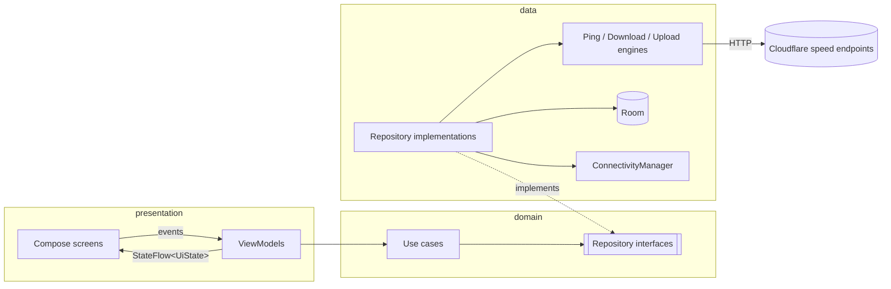

# Network Speed Test

[](https://github.com/willyrafaelfs/Network-Speed-Test/actions/workflows/ci.yml)
[](https://gitlab.com/willyrafaelfs/Network-Speed-Test/-/pipelines)


[](LICENSE)

An Android app that measures your connection's **ping, jitter, download, and upload speed** in real time,
built with Jetpack Compose and Clean Architecture.

> Screenshots and a demo GIF are coming with the UI refresh.

## Features

- **Full speed test**: ping → download → upload, with a live animated gauge and per-phase progress
- **Latency & jitter**: averaged HTTP round-trips after a warm-up request, so the TLS handshake isn't counted
- **Real-time sampling**: throughput is emitted every 300 ms as a Kotlin `Flow`
- **Network info**: connection type (Wi-Fi / cellular / Ethernet / VPN), SSID or carrier name, and public IP,
  updated live as the network changes
- **History**: every result is stored locally with Room, and can be deleted one by one or all at once
- **Cancellable**: stopping a test cancels the running measurement and closes its connections

## Tech stack

| Area | Libraries |
|---|---|
| UI | Jetpack Compose, Material 3, Canvas-drawn gauge |
| Architecture | Clean Architecture (domain / data / presentation), MVVM, unidirectional data flow |
| Async | Kotlin Coroutines & Flow (`callbackFlow`, `flatMapLatest`, `stateIn`) |
| Networking | OkHttp 5 |
| Persistence | Room (with exported schemas) |
| DI | Hilt |
| Quality | Spotless + ktlint (with Compose rules), Detekt, Android Lint (warnings as errors) |
| CI | GitHub Actions & GitLab CI |

## Architecture



- **domain** is pure Kotlin: models, repository contracts, and use cases. `RunSpeedTestUseCase` orchestrates the
  ping → download → upload phases and emits a `SpeedTestProgress` stream.
- **data** implements the contracts. Each engine measures one metric and exposes its samples as a `Flow`.
- **presentation** holds Hilt ViewModels that expose an immutable `UiState` through `StateFlow`, and stateless
  composables that render it.

## How the measurement works

| Metric | Method |
|---|---|
| Ping | 10 sequential HTTP requests to a 0-byte endpoint after one warm-up request; the result is the mean RTT |
| Jitter | Mean absolute difference between consecutive ping samples |
| Download | Streams a large response for 10 s, counting the bytes received, and repeats the request if the file ends early |
| Upload | Streams random (incompressible) data in a POST body for 10 s, counting the bytes written |

ICMP ping needs root access on Android, so HTTP round-trip time is used as the latency proxy.

**Known limitations** (planned improvements): the engines use a single TCP connection and include the TCP
slow-start ramp-up in the average, so on very fast links (>100 Mbps) results can come out lower than in
multi-stream tools.

## Getting started

**Requirements:** Android Studio (latest stable), JDK 21, Android SDK 37.

```bash
git clone https://github.com/willyrafaelfs/Network-Speed-Test.git
cd Network-Speed-Test
./gradlew assembleDebug        # APK in app/build/outputs/apk/debug/
```

Or open the project in Android Studio and run the `app` configuration.

### Quality checks

```bash
./gradlew spotlessApply        # auto-format Kotlin & Gradle scripts
./gradlew spotlessCheck detekt lintDebug testDebugUnitTest   # what CI runs
```

## Project structure

```
app/src/main/java/io/github/willyrafaelfs/speedtest/
├── domain/          # models, repository interfaces, use cases (no Android dependencies)
├── data/
│   ├── remote/      # ping, download & upload engines (OkHttp)
│   ├── local/       # Room database, DAO, entities + mappers
│   ├── repository/  # repository implementations
│   └── di/          # Hilt modules
├── presentation/
│   ├── speedtest/   # test screen, ViewModel, UI state
│   ├── history/     # history screen, ViewModel, UI state
│   └── component/   # reusable composables (gauge, cards)
└── ui/theme/        # Material 3 theme
```

## Roadmap

- [x] Project foundation: CI on GitHub & GitLab, formatting, static analysis
- [ ] More accurate engine: parallel streams, ramp-up exclusion, loaded latency (bufferbloat grade)
- [ ] UI refresh: custom design system, live throughput chart, English & Indonesian localization
- [ ] History details with trend charts, shareable result card, and settings
- [ ] Broader test coverage (ViewModel, engine, Room, Compose UI and screenshot tests)
- [ ] Signed release builds published to GitHub & GitLab Releases

## License

Released under the [MIT License](LICENSE).
