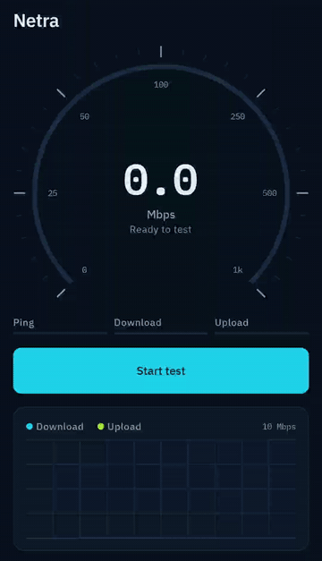
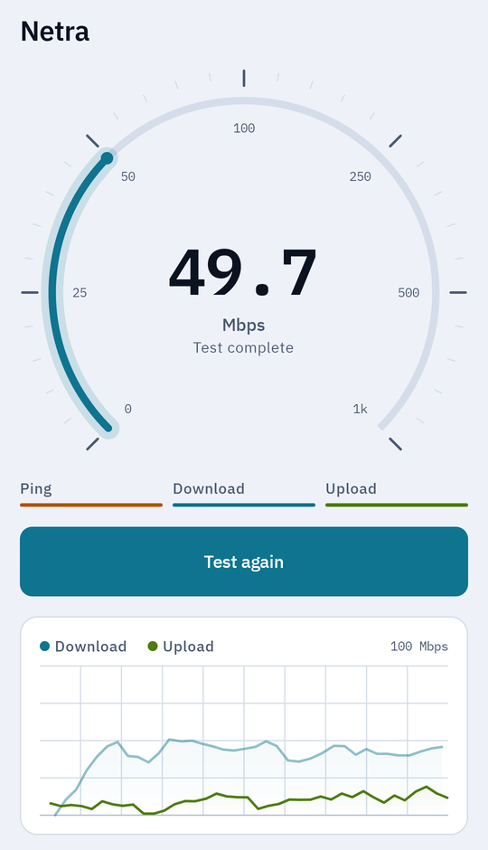
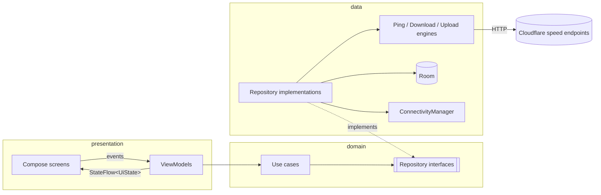

# Netra

[](https://github.com/willyrafaelfs/Network-Speed-Test/actions/workflows/ci.yml)
[](https://gitlab.com/willyrafaelfs/Network-Speed-Test/-/pipelines)


[](LICENSE)

Netra is an Android network speed test that measures **ping, jitter, download, upload, and latency under load**
in real time. It's built with Jetpack Compose and Clean Architecture. The name means "eye" in Sanskrit and
Javanese: an instrument for seeing how your connection behaves.

| Live test (dark) | Result (light) | History |
|---|---|---|
|  |  |  |

## Features

- **Full speed test**: ping → download → upload, with a live animated gauge and per-phase progress
- **Multi-stream engine**: 4 parallel TCP connections, TCP slow-start excluded, and the result reported as the
  90th percentile of 1-second windows
- **Accurate upload**: the final result only counts bytes the server has acknowledged, not bytes sitting in the
  socket send buffer
- **Latency under load & bufferbloat grade (A+ to F)**: ping keeps running during download and upload
- **Latency & jitter**: averaged HTTP round-trips after a warm-up request, so the TLS handshake isn't counted
- **Real-time sampling**: throughput is emitted every 250 ms as a Kotlin `Flow`
- **Clear errors**: no connection, timeout, and server rejection are told apart and explained in plain language
- **Instrument-style UI**: custom design system (navy base, one color per channel: cyan download, lime upload,
  amber latency), IBM Plex with tabular numerals, a ticked dial, and an oscilloscope-style live chart
- **Light & dark themes**, English and Indonesian (with per-app language on Android 13+)
- **Adaptive layout**: bottom bar on phones, navigation rail and two panes in landscape and on tablets
- **Accessible**: every reading is announced as one sentence, touch targets are at least 48 dp, and layouts
  scroll at large font sizes
- **Network info**: connection type (Wi-Fi / cellular / Ethernet / VPN), SSID or carrier name, and public IP,
  updated live as the network changes
- **History**: every result is stored locally with Room, and can be deleted one by one or all at once
- **Cancellable**: stopping a test cancels the running measurement and closes its connections

## Tech stack

| Area | Libraries |
|---|---|
| UI | Jetpack Compose, Material 3 (custom theme), Canvas-drawn dial & chart, SplashScreen API |
| Navigation | Navigation Compose with type-safe routes, Material 3 adaptive navigation suite |
| Architecture | Clean Architecture (domain / data / presentation), MVVM, unidirectional data flow |
| Async | Kotlin Coroutines & Flow (`callbackFlow`, `flatMapLatest`, `stateIn`) |
| Networking | OkHttp 5 |
| Persistence | Room (with exported schemas) |
| DI | Hilt |
| Quality | Spotless + ktlint (with Compose rules), Detekt, Android Lint (warnings as errors) |
| CI | GitHub Actions & GitLab CI |

## Architecture



- **domain** is pure Kotlin: models, repository contracts, and use cases. `RunSpeedTestUseCase` orchestrates the
  ping → download → upload phases and emits a `SpeedTestProgress` stream.
- **data** implements the contracts. Each engine measures one metric and exposes its samples as a `Flow`.
- **presentation** holds Hilt ViewModels that expose an immutable `UiState` through `StateFlow`, and stateless
  composables that render it.

## How the measurement works

| Metric | Method |
|---|---|
| Ping | 10 sequential HTTP requests to a 0-byte endpoint after one warm-up request; the result is the mean RTT |
| Jitter | Mean absolute difference between consecutive ping samples (RFC 3550 style) |
| Download | 4 parallel HTTP/1.1 connections for 10 s. The first 2 s (TCP slow start) are dropped, and the result is the 90th percentile of 1 s sliding windows |
| Upload | 4 parallel connections repeatedly POST fixed-size random bodies (64 KiB, doubling up to 16 MiB). The final result counts only requests the server has answered |
| Latency under load | A ping every 500 ms on a separate connection while download/upload runs; the median per phase |
| Bufferbloat grade | Worst latency increase over idle, graded with the [Waveform](https://www.waveform.com/tools/bufferbloat) thresholds (A+ ≤ 5 ms … F > 400 ms) |

ICMP ping needs root access on Android, so HTTP round-trip time is used as the latency proxy. The reasoning
behind each choice, the alternatives considered, and the limitations are written up in
[ADR 001: Measurement methodology](docs/adr/001-measurement-methodology.md).

**Known limitations:** HTTP RTT reads slightly higher than ICMP ping, all traffic goes to the nearest
Cloudflare edge, and one connection failing mid-test fails the whole phase.

## Getting started

**Requirements:** Android Studio (latest stable), JDK 21, Android SDK 37.

```bash
git clone https://github.com/willyrafaelfs/Network-Speed-Test.git
cd Network-Speed-Test
./gradlew assembleDebug        # APK in app/build/outputs/apk/debug/
```

Or open the project in Android Studio and run the `app` configuration.

### Quality checks

```bash
./gradlew spotlessApply        # auto-format Kotlin & Gradle scripts
./gradlew spotlessCheck detekt lintDebug testDebugUnitTest   # what CI runs
```

## Project structure

```
app/src/main/java/io/github/willyrafaelfs/speedtest/
├── domain/          # models, repository interfaces, use cases (no Android dependencies)
├── data/
│   ├── remote/      # ping, download & upload engines (OkHttp) + pure throughput math
│   ├── local/       # Room database, DAO, entities + mappers
│   ├── repository/  # repository implementations
│   └── di/          # Hilt modules
├── presentation/
│   ├── navigation/  # app scaffold, type-safe routes, adaptive navigation
│   ├── speedtest/   # test screen, ViewModel, UI state, location permission flow
│   ├── history/     # history screen, ViewModel, UI state
│   ├── component/   # instrument dial, live chart, readouts, panels
│   └── format/      # locale-aware number formatting, labels
└── ui/theme/        # Netra design system: colors, type, shapes, spacing
```

## Roadmap

- [x] Project foundation: CI on GitHub & GitLab, formatting, static analysis
- [x] More accurate engine: parallel streams, ramp-up exclusion, loaded latency (bufferbloat grade)
- [ ] Benchmark against Ookla Speedtest and Cloudflare on the same network
- [x] UI refresh: custom design system, live throughput chart, English & Indonesian localization
- [ ] History details with trend charts, shareable result card, and settings
- [ ] Broader test coverage (ViewModel, engine, Room, Compose UI and screenshot tests)
- [ ] Signed release builds published to GitHub & GitLab Releases

## License

Released under the [MIT License](LICENSE). The bundled IBM Plex Sans and IBM Plex Mono fonts are licensed under
the [SIL Open Font License 1.1](app/src/main/assets/licenses/ibm-plex-OFL.txt).
